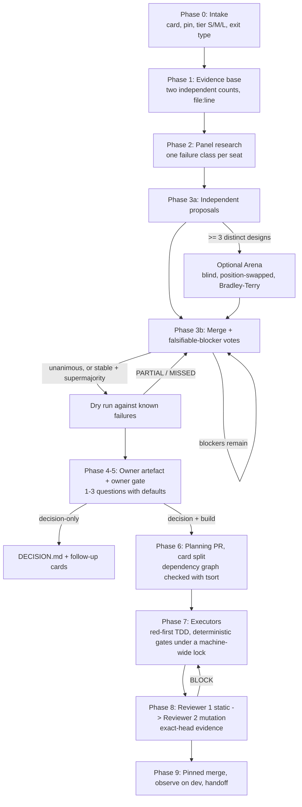

# Olympus

**Panel decisions for software agents: independent proposals, blind judging, falsifiable debate, an owner gate, then verified delivery.**

Olympus is an agent skill. It takes a software question, such as "redesign these 180 dialogs", "move this flow to a new architecture" or "how should sessions be revoked when a role changes?". It answers with a decision that a group of agents has argued to consensus. When code must follow, it ships that decision through a gated pipeline with two independent reviews.

The core premise comes from the research below. Single-agent design and LLM self-review fail in predictable ways. A useful multi-agent process therefore has to be built around those failure modes; adding more agents is not enough.

---

## Contents

1. [Why a panel, and why this kind of panel](#1-why-a-panel-and-why-this-kind-of-panel)
2. [Design principles and the evidence behind them](#2-design-principles-and-the-evidence-behind-them)
3. [The process](#3-the-process)
4. [Case study: Olympus designed by Olympus](#4-case-study-olympus-designed-by-olympus)
5. [Domain packs](#5-domain-packs)
6. [Install and adapt](#6-install-and-adapt)
7. [Limitations and threats to validity](#7-limitations-and-threats-to-validity)
8. [References](#8-references)

---

## 1. Why a panel, and why this kind of panel

Agentic coding tools are good at producing *a* plan. They are poor at noticing which plan they did not consider. Olympus came out of a concrete incident. A UI rollout across many screens was planned by one agent with no debate. It shipped in four reviewed PRs, and the later handoffs still listed gaps that a debate on accessibility, data contracts and money handling would have raised before any code was written.

Adding agents does not fix this by itself. Three findings shaped the design:

- **Debate is not where most of the gain comes from.** Multi-agent debate improves factuality and reasoning [3], but across debate benchmarks, majority voting over *independent* answers accounts for most of the improvement usually credited to debate. Debate by itself behaves like a martingale: it does not improve expected correctness [4].
- **Discussion can make answers worse.** Agents drift from correct to incorrect answers to agree with peers [5]. Unguided homogeneous debate converges through conformity and can underperform isolated self-correction [6]. Agreement on the answer can hide reasoning that diverges underneath it [7].
- **LLMs are unreliable judges of their own work.** Without external feedback, self-correction does not reliably improve reasoning and sometimes degrades it [8]. LLM judges also show position, verbosity and self-enhancement biases [9, 10, 11].

Olympus keeps what works (independent proposals, aggregation, structured critique) and puts a mechanical guard in front of each known failure mode.

---

## 2. Design principles and the evidence behind them

| # | Principle | What Olympus does | Grounding |
|---|---|---|---|
| P1 | **Independence before interaction** | Each seat writes a full proposal alone before reading anyone else's. | Condorcet's jury theorem and its modern restatement in Surowiecki: aggregation helps only when errors are independent [1, 2]. Self-consistency gains come from sampling diverse reasoning paths [12]. Voting over independent answers is the main source of multi-agent gains [4]. |
| P2 | **Diverse, adversarial roles** | Each seat owns a *failure class* (money truth, access, visual system, attacker, delivery…), not a topic. | Distinct role prompts are essential in multi-agent evaluation [13]. Multi-agent failures cluster into system design, inter-agent misalignment and task verification [14]. Seats are assigned to cover those categories. The idea goes back to Minsky's *Society of Mind* [15]. |
| P3 | **Blind, position-swapped pairwise judging** (optional Arena) | When ≥ 3 materially different designs exist: authors are stripped, order is shuffled, each pair is judged twice with positions swapped by two non-authors, and results are aggregated with Bradley–Terry. | LLM judges show position, verbosity and self-enhancement bias [9]; CALM catalogues 12 judge biases [10]; judges prefer their own text [11]. Anonymising agents reduces identity-driven sycophancy [16]. Pairwise preference with Bradley–Terry is the Chatbot Arena method [17, 18]. |
| P4 | **Falsifiable blockers only** | A BLOCK must name a location, the claim that the evidence does not support, and a concrete replacement. Anything else is a non-voting minor. A vote may change only on evidence, never to agree. | Popper's criterion: a claim worth debating must be refutable [19]. This counters the conformity drift in [5, 6] and the "consistency illusion" in [7]: an AGREE must list how each earlier blocker was resolved. |
| P5 | **One aggregator, typed artefacts** | A single chair merges proposals into versioned drafts and keeps every vote and ruling in files, not chat. | Mixture-of-Agents: proposers feeding an aggregator outperform single models [20]. Typed artefacts between roles, as in MetaGPT, reduce cascading hallucination [21]. |
| P6 | **Stop on stability, not exhaustion** | Halt when the vote is unanimous, or when the blocker count stops falling for two rounds (then a supermajority with recorded dissent), or at a round budget. | Delphi method: anonymous iterated rounds stopped at stability [22]. Adaptive stability detection for debate [23]. Semantic early stopping cut tokens by 38 % at parity quality in iterative agent loops [24]. Failing episodes can be predicted and aborted early [25]. |
| P7 | **Pre-mortem before the gate** | After consensus, the decision is replayed against known past failures, and each one must map to a named, mechanical step. | Klein's project pre-mortem: imagining the failure surfaces risks that forward planning misses [26]. |
| P8 | **Owner decides, with defaults** | The human sees ≤ 1 screen of summary and 1–3 questions, each with a recommended default and a one-line reason. | Defaults strongly shape choices under limited attention [27]. A good default makes the safe path the cheap path. |
| P9 | **External verification, never self-review** | The author never judges its own work. Deterministic gates run first; then a static reviewer; then a mutation-testing reviewer in an isolated copy. | Self-correction without external feedback is unreliable [8]. Mutation testing measures whether tests detect injected faults [28, 29]. It works at industrial scale when restricted to changed code [30], and mutants make good test-generation goals [31]. Agents under test pressure edit the tests [32], so skips, loosened assertions and snapshot updates each need a stated reason. |
| P10 | **Fact checks go to the strongest available checker** | "Does this tool, flag or path exist?" is answered by a command or a stronger model, never by a light-tier judge. | An observation from the case study (§4), consistent with the limited reasoning ability of LLM judges [9]. |

---

## 3. The process



Key properties:

- **Two exits.** *Decision-only* ends with an approved `DECISION.md` and follow-up cards, for example an architecture or security posture. *Decision + build* continues into delivery.
- **Tiers.** Small changes that an existing decision already covers skip the panel. Medium and large ones get 3 or 5 seats and a round budget.
- **Machine-load discipline.** Every test suite, type check, browser run and mutant run goes through one FIFO lock, so parallel agents cannot exhaust the machine.
- **Exact-head evidence.** Reviews, test evidence and the merge are pinned to one commit SHA. A new commit invalidates them.

---

## 4. Case study: Olympus designed by Olympus

Olympus's own `SKILL.md` was produced by the process it describes. The record below comes from the vote and tally files of that run. It is a **single case**, not a controlled experiment (see §7).

**Setup**
- **Panel.** Six seats: three mid-tier and three light-tier agents. They were a process architect, a verification skeptic, a tooling engineer, a design critic, a cost economist and a red team.
- **Chair.** A frontier-tier model.
- **Inputs.** Each seat researched its angle (45 sources) and then wrote a complete candidate skill independently.

**Blind Arena (6 candidates, 15 pairs, each judged twice with positions swapped = 30 judgments)**
- **Invented tools.** Three of the six candidates cited a script that does not exist in the repository.
  - The mid-tier judges flagged it every time.
  - The light-tier judges did not; one even penalised a real tool as invented.
- **Effect of the rubric's cap.** Enforcing the rubric's safety cap for invented tools changed 11 of 30 verdicts, most of them to ties.
  - All three candidates with the invented script moved to the bottom.
  - The three without it formed a statistical tie at the top.

**Debate (rounds 3–20)**

| Rounds | Draft | AGREE votes | Accepted blockers |
|---|---|---|---|
| 3–12 | v1–v10 | 0/6 → 5/6 | 15, 5, 3, 3, 2, 3, 2, 10, 2, 1 |
| 13 | v11 | **6/6** | 0, then the pre-mortem found 2 partial gaps |
| 14–16 | v12–v14 | 5/6, 5/6, **6/6** | 3, 2, 0 |
| 17–20 | v15–v17, after the owner widened scope to any software decision | 2/6 → 5/6 | 7, 7, 1 |

**What the panel caught.** Many accepted blockers came from *executing* the draft's instructions against the real repository, not from reading them. Examples:
- a merge command form the repository's merge gate rejects;
- a test lock that is not re-entrant, so a nested call would deadlock for an hour;
- a `grep` wrapper that printed a false blank line, failing a validity check;
- a report format the review launcher rejects;
- a runtime-config query that would have copied bearer tokens into committed evidence.

**Observations** (hypotheses for further study, not established results):
1. **Consensus is not correctness.** The light-tier seats voted AGREE from round 4 onward. Of the 51 blockers accepted from round 4, all but four were raised by mid-tier seats alone. This is consistent with conformity-driven agreement [5, 6, 7], and it is why P10 exists.
2. **Unanimity is not enough.** A unanimous v11 still failed 2 of 11 pre-mortem items, both later fixed. This supports P7.
3. **Unvoted edits regress.** In round 5 the chair made three quick fixes between votes. All three were found defective in round 6. After that, every substantive edit went to a vote.
4. **Most defects lived at the tool boundary.** Wrong flags, path filters, launcher contracts and lock semantics. These are exactly what a text-only review misses and an executing reviewer catches. This supports P9.

---

## 5. Domain packs

`SKILL.md` is topic-neutral. A pack in `references/domains/` defines, for one domain:
- its evidence base;
- the artefact the owner sees;
- the required proposal content;
- its verification gates;
- its default seats;
- its mutation families and test runner.

| Pack | Evidence base | Owner artefact | Distinctive gates |
|---|---|---|---|
| `ui-redesign.md` | real-screen inventory (every surface, `file:line`, click path, family) | mockups that reproduce the real screen and show only the delta | state table before sketches; exposure rules by data direction; accessibility acceptance (keyboard, screen reader, 320/375 px, 200 % zoom, contrast, reduced motion); data contract per view |
| `architecture.md` | current-state map from code, including serverless functions and migrations | options as ADRs with trade-offs, reversibility and rollback | characterisation tests green on the old path first; migration specs; fitness checks |
| `security.md` | threat model: assets, actors, entry points; runtime config the code cannot show | threat model with ranked risks | probes against non-production only; tenant-isolation checks; no secrets in any artefact |

Adding a domain means adding a pack; `SKILL.md` does not change.

---

## 6. Install and adapt

Copy this directory into your agent's skills folder, for example `.claude/skills/olympus/` or `.agents/skills/olympus/`.

Olympus was written against one repository's agent harness. Its commands name that harness's tools:
- a worktree manager;
- a machine-wide test lock;
- a review-record verifier;
- a GitHub CLI wrapper;
- an evidence checker;
- a fleet dispatcher.

`references/commands.md` lists each one with its flags. Map each to your own equivalent before use, or remove it. Placeholders such as `<your probe runner>` mark the places to adapt. The *process* (phases, vote format, judging protocol, stop rules and gates) is independent of those tools.

```
SKILL.md                  the skill: frontmatter + process (phases, gates, roles)
references/               panel and executor briefs, judging protocol, reviewer briefs, commands, evals, Jev rules
references/domains/       domain packs
tools/                    optional: multi-provider runner, Jev steps and calibration, with offline tests
```

### Optional: Jev (TypeSafe)

Olympus does **not** require Jev. Everything above works without it, and any Jev failure becomes `jev: UNAVAILABLE` while the process continues.

[Jev](https://docs.typesafe.ai/introduction) is a decision model, not a text generator. You define the possible answers, and it returns typed answers with probabilities, as a Choice, a Score or a Noul (a yes/no probability). Olympus tested it on the K-2036 record and with a live Arena, and one use survived: a **verdict meta-check**.

| Step | Jev question | Status |
|---|---|---|
| **J1 Arena verdict meta-check** | Noul per verdict: "is this verdict correct?", asked with both candidates in both orders | **SHADOW at ship** (calls and logs only); ADVISORY only after seeded calibration |
| J2 Jev as an Arena judge | Choice | rejected: order-consistent in 3/6 pairs, and its consistent picks favoured the last-ranked proposal |
| J3 blocker triage, J4 dry-run cross-check | Noul, Choice | rejected: 2/5 and 14/27 on the record |
| J5 stop rule, J6 reviewer over-flagging | Score, Noul | off, would need their own shadow table |
| J7 approval P(correct) | Noul | forbidden: Brier 0.227 against 0.149 for a constant |

What J1 does, in order: the President records the ruling (ranking and base choice, by blind code) first; only then does `tools/jev_steps.py j1` ask Jev about each verdict; P stays out of every vote, `judging-results.md` and DECISION.md. In ADVISORY a low P or an unstable pair (the two orders disagree by more than 0.20) can only **add** one more blind judgment from a non-author; it can never remove a check, approve anything or carry a Bradley-Terry weight. Evidence so far: AUC 0.81 on 24 verdicts labelled by mid-tier judges (about 0.63-0.99), and a live run whose 12 P values changed no ranking. That is not enough to promote, so promotion needs the pre-registered calibration below.

- **Consent.** `jev: off | shadow | advisory` (default off) and `jev-content: ok | blocked` (default blocked) are asked at phase 0. A pre-send scan skips the run on key-like strings, credentials and a few domain words; it is a tripwire, not a guarantee. TypeSafe states a no-training commitment, but its retention terms are unverified, so sending anything is the owner's decision.
- **Pin.** The adapter accepts only a pinned model (`jev-1.13.0`); `jev-latest` and `jev-preview` are rejected, the response model is checked, and the question wording is frozen with a sha256.
- **Cost.** $0.042 per million input tokens, output free ([models](https://docs.typesafe.ai/models)): about $0.007 per Arena.
- **Calibration.** Promotion to ADVISORY needs at least 30 independently authored seed pairs (a pair has one planted, checkable defect) from at least 2 authors and at least 20 wrong verdicts, a cluster-bootstrap AUC whose 2.5th percentile is at least 0.70 and beats the word-count baseline, and stable P across orders. The seed pack is deliberately not shipped: its answer key is committed as a hash and revealed only after the ruling. See `references/jev.md` and the recipe `references/jev-seeds.md`; `tools/jev_calibrate.py` prints PROMOTE, HOLD or RETIRE.

To try it:

```
cp .env.example .env                                        # .env is git-ignored; never commit it
# edit .env and set TYPESAFE_API_KEY
cp olympus.providers.example.json olympus.providers.json    # keep the `jev` target (typesafe adapter, jev-1.13.0)
python3 tools/olympus_call.py --target jev --brief brief.json --out out.json --dry-run
```

No SDK is needed: the `typesafe` adapter of `tools/olympus_call.py` uses only the standard library.

### Optional: other model providers

Olympus does **not** require this either. By default every seat, judge and reviewer is a native subagent of the host agent. If you want some of them on a different model family (an Arena judge, reviewer 2, an extra seat), `tools/olympus_call.py` sends a brief file to one configured target and writes the answer to a file. It is one script, Python 3.9+, standard library only.

| Adapter | Providers | Notes |
|---|---|---|
| `openai` | OpenAI, OpenRouter, Moonshot (Kimi), and any OpenAI-compatible server through `base_url` (Ollama, vLLM, DeepSeek, Groq, Together) | `POST {base_url}/chat/completions`, Bearer key; Ollama needs no key |
| `anthropic` | Anthropic API | `POST {base_url}/v1/messages`, `x-api-key` and `anthropic-version` headers |
| `typesafe` | TypeSafe System One (Jev), the optional verdict meta-check above | `POST https://api.typesafe.ai/v1/systemone`, Bearer key; the brief is JSON (`state`, `questions`); pinned `jev-X.Y.Z` model only |
| `cli` | `codex exec`, `claude -p`, any command that reads a prompt on stdin | no shell: an argv list; the CLI may use its own tools and its own login |

Setup:

```
cp olympus.providers.example.json olympus.providers.json   # git-ignored; edit models and targets
cp .env.example .env                                       # git-ignored; set only the keys you use
python3 tools/olympus_call.py --target kimi --brief brief.md --out out.md --dry-run
python3 tools/olympus_call.py --target kimi --brief brief.md --out out.md
python3 -m unittest tools/test_olympus_call.py             # offline tests
```

Replace every `<placeholder>` model id with one from the provider's own model list; the example file does not pin ids it could not verify. Keys come from the process environment first, then from `.env`, and are never printed or written to the output or its `.meta.json`. Requests make up to 3 attempts (2 retries) on 429, 5xx and connection errors; a request that times out is not retried, because a hung provider may still be generating and billing (add `--retry-timeouts` to opt in). `--config` and `--env` default to files in the repository root, never the current directory, and `api_key_env` names must look like `SOMETHING_API_KEY`. API targets cannot use tools, so the chair pastes the evidence into the brief; CLI targets can. Mixing model families weakens the correlated-judge limitation ([§7](#7-limitations-and-threats-to-validity)).

**Data sharing:** a brief sent to a non-host provider leaves your machine and may contain source code or other confidential material. Whether a given repository may be sent to a given provider is your decision, and the process records which provider saw what. Never copy OAuth tokens out of another tool's auth files; use an API key or that tool's own login.

---

## 7. Limitations and threats to validity

- **One case, no control group.** The case study is a single run on a single codebase. There is no comparison against a single-agent baseline or other panel sizes.
- **Correlated judges.** All seats came from one model family. Shared training can produce correlated errors, which weakens the independence assumption behind P1 [1, 2].
- **Chair influence.** The chair also wrote the rulings, so its own biases are not blinded. Every ruling is recorded with a reason, but the chair was not anonymised.
- **Jev is unvalidated.** J1 ships in SHADOW. Its evidence is 24 verdicts labelled by mid-tier judges and one live Arena, and the seeded-defect calibration that could promote it (30 pairs) has not been run. It validates seeded-defect verdicts only.
- **Cost.** A full run (6 seats, 20 rounds, 2 reviewers) is expensive. Tiering, the decision-only exit and the stop rules exist to scale it down. The run did not measure token cost precisely.
- **Tool coupling.** The delivery phases assume a specific harness (see §6). The decision phases transfer more readily than the delivery phases.
- **Non-stationary findings.** Several cited results are 2025–2026 preprints, and model behaviour changes quickly.

---

## 8. References

1. Condorcet, M. de (1785). *Essai sur l'application de l'analyse à la probabilité des décisions rendues à la pluralité des voix.*
2. Surowiecki, J. (2004). *The Wisdom of Crowds.* Doubleday.
3. Du, Y., Li, S., Torralba, A., Tenenbaum, J. B., Mordatch, I. (2023). Improving Factuality and Reasoning in Language Models through Multiagent Debate. https://arxiv.org/abs/2305.14325
4. Choi, H. K., et al. (2025). Debate or Vote: Which Yields Better Decisions in Multi-Agent Large Language Models? https://arxiv.org/abs/2508.17536
5. Wynn, A., et al. (2025). Talk Isn't Always Cheap: Understanding Failure Modes in Multi-Agent Debate. https://arxiv.org/abs/2509.05396
6. Bertalanič, B., Fortuna, C. (2026). The Cost of Consensus: Isolated Self-Correction Prevails Over Unguided Homogeneous Multi-Agent Debate. https://arxiv.org/abs/2605.00914
7. Wang, X., Yang, C. C. (2026). The Consistency Illusion: How Multi-Agent Debate Hides Reasoning Misalignment. https://arxiv.org/abs/2606.08457
8. Huang, J., et al. (2023). Large Language Models Cannot Self-Correct Reasoning Yet. https://arxiv.org/abs/2310.01798
9. Zheng, L., et al. (2023). Judging LLM-as-a-Judge with MT-Bench and Chatbot Arena. https://arxiv.org/abs/2306.05685
10. Ye, J., et al. (2024). Justice or Prejudice? Quantifying Biases in LLM-as-a-Judge. https://arxiv.org/abs/2410.02736
11. Wataoka, K., et al. (2024). Self-Preference Bias in LLM-as-a-Judge. https://arxiv.org/abs/2410.21819
12. Wang, X., et al. (2022). Self-Consistency Improves Chain of Thought Reasoning in Language Models. https://arxiv.org/abs/2203.11171
13. Chan, C.-M., et al. (2023). ChatEval: Towards Better LLM-based Evaluators through Multi-Agent Debate. https://arxiv.org/abs/2308.07201
14. Cemri, M., et al. (2025). Why Do Multi-Agent LLM Systems Fail? https://arxiv.org/abs/2503.13657
15. Minsky, M. (1986). *The Society of Mind.* Simon & Schuster.
16. Choi, H. K., et al. (2025). When Identity Skews Debate: Anonymization for Bias-Reduced Multi-Agent Reasoning. https://arxiv.org/abs/2510.07517
17. Chiang, W.-L., et al. (2024). Chatbot Arena: An Open Platform for Evaluating LLMs by Human Preference. https://arxiv.org/abs/2403.04132
18. Bradley, R. A., Terry, M. E. (1952). Rank Analysis of Incomplete Block Designs: I. The Method of Paired Comparisons. *Biometrika* 39(3/4), 324–345.
19. Popper, K. (1959). *The Logic of Scientific Discovery.* Hutchinson.
20. Wang, J., et al. (2024). Mixture-of-Agents Enhances Large Language Model Capabilities. https://arxiv.org/abs/2406.04692
21. Hong, S., et al. (2023). MetaGPT: Meta Programming for a Multi-Agent Collaborative Framework. https://arxiv.org/abs/2308.00352
22. Dalkey, N., Helmer, O. (1963). An Experimental Application of the Delphi Method to the Use of Experts. *Management Science* 9(3), 458–467.
23. Adaptive stability detection for multi-agent debate (NeurIPS 2025). https://proceedings.neurips.cc/paper_files/paper/2025/hash/42475c537936b2394b5015e871765056-Abstract-Conference.html
24. Shrivastava, S. (2026). Semantic Early-Stopping for Iterative LLM Agent Loops. https://arxiv.org/abs/2606.27009
25. Ruan, K., et al. (2026). Doomed from the Start: Early Abort of LLM Agent Episodes via a Recall-Controlled Probe Cascade. https://arxiv.org/abs/2607.06503
26. Klein, G. (2007). Performing a Project Premortem. *Harvard Business Review* 85(9), 18–19.
27. Johnson, E. J., Goldstein, D. (2003). Do Defaults Save Lives? *Science* 302(5649), 1338–1339.
28. DeMillo, R. A., Lipton, R. J., Sayward, F. G. (1978). Hints on Test Data Selection: Help for the Practicing Programmer. *IEEE Computer* 11(4), 34–41.
29. Jia, Y., Harman, M. (2011). An Analysis and Survey of the Development of Mutation Testing. *IEEE Transactions on Software Engineering* 37(5), 649–678.
30. Petrović, G., Ivanković, M., Fraser, G., Just, R. (2021). Practical Mutation Testing at Scale. https://arxiv.org/abs/2102.11378
31. Foster, C., et al. (2025). Mutation-Guided LLM-based Test Generation at Meta. https://arxiv.org/abs/2501.12862
32. ImpossibleBench: Measuring Reward Hacking in LLM Coding Agents (2025). https://www.lesswrong.com/posts/qJYMbrabcQqCZ7iqm/impossiblebench-measuring-reward-hacking-in-llm-coding-1

---

## License

MIT. See `LICENSE`.
